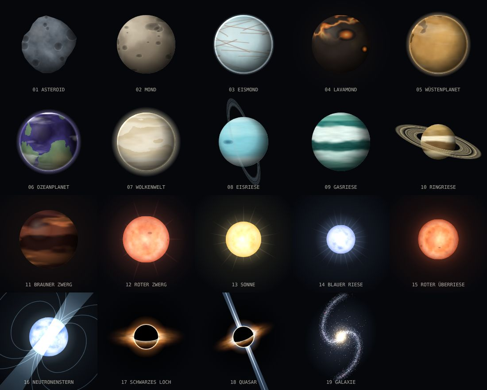
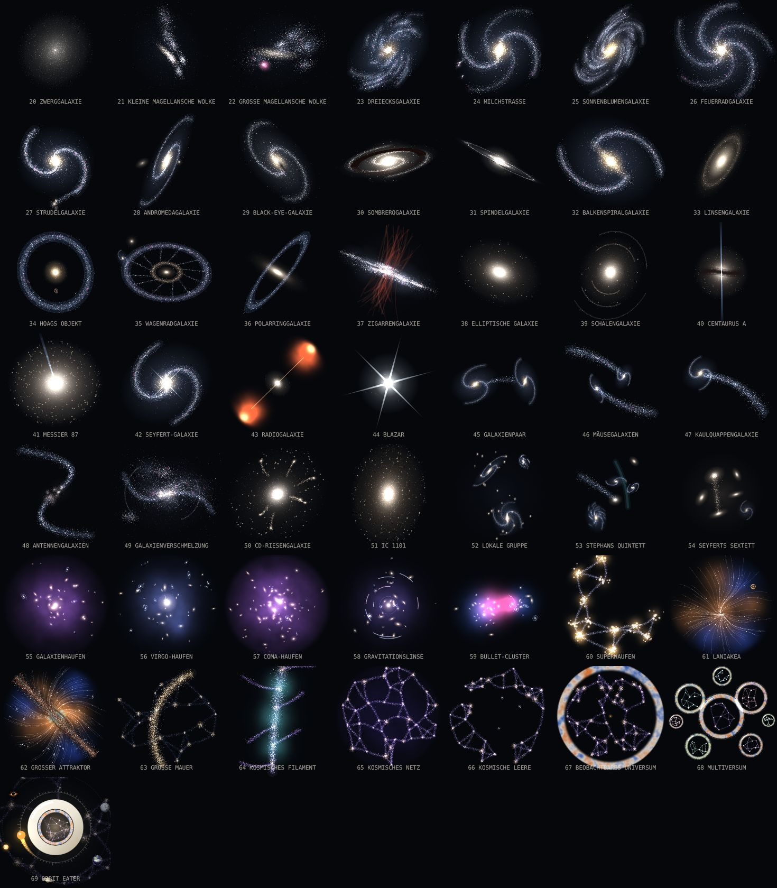

# ORBIT EATER

**Ein Browserspiel über Schwerkraft und Appetit.** Du bist ein kleiner Himmelskörper in einer
kreisrunden Arena. Friss, was kleiner ist, meide, was größer ist, und nutze deine eigene
Schwerkraft: Staub fällt in Spiralen auf dich zu, Asteroiden gehen in deine Umlaufbahn und
werden zu Munition. 69 Stufen: vom Asteroiden über Monde, Planeten, Riesen und Sterne bis zum
Schwarzen Loch und zur Galaxie. Danach geht es weiter, durch 50 echte Galaxientypen, Haufen
und das kosmische Netz bis zum Multiversum. Die letzte Stufe ist das Spiel selbst.

Inspiriert vom Spielgefühl von slither.io und agar.io, aber mit eigener Mechanik
(Gravitation, Orbits, Schleuder) und eigener Gestaltung.


- Vanilla JavaScript (ES-Module) und Canvas 2D, ohne Framework und ohne Build-Schritt.
- **Keine einzige Asset-Datei:** Grafik, Texturen und Sounds entstehen zur Laufzeit im Code.
- Große Arena mit 80 KI-Gegnern und über 5.000 Objekten gleichzeitig, fester 60-Hz-Physiktakt.

---

## Starten

**Am schnellsten:** `dist/orbit-eater.html` per Doppelklick öffnen. Das ist das komplette
Spiel in einer einzigen Datei, ohne Server und ohne Internet. Gut zum Weitergeben.

**Für die Entwicklung:** ES-Module laden nicht über `file://`. Ein Doppelklick auf
`index.html` reicht deshalb nicht, das Spiel braucht einen kleinen lokalen Webserver. Eine
der folgenden Varianten genügt:

```bash
cd orbit-eater

npm start                    # eigener Mini-Server ohne Abhängigkeiten → http://localhost:8080
npx serve .                  # oder
python -m http.server 8000   # oder
```

Danach die angezeigte Adresse im Browser öffnen. Läuft in aktuellen Versionen von Chrome,
Edge, Firefox und Safari, am Desktop wie am Handy. Wer `index.html` trotzdem per Doppelklick
öffnet, bekommt einen Hinweis angezeigt statt eines schwarzen Bildschirms.

**Neu bauen** (nach Änderungen am Code):

```bash
npm run build      # → dist/orbit-eater.html
```

`tools/build.mjs` ist ein kleiner Bundler ohne Abhängigkeiten. Er gibt jedem Modul einen
eigenen Scope, macht aus Importen Zugriffe auf das exportierende Modul und legt CSS und
JavaScript inline in eine HTML-Datei.

## Steuerung

| Desktop | | Touch | |
|---|---|---|---|
| **Maus** | Richtung und Tempo (je weiter weg, desto schneller) | **Ziehen** | schwebender Joystick |
| **Shift** / **Leertaste** | Boost, kostet Masse | **2. Finger** oder **BOOST** | Boost |
| **Maustaste halten** | Schleuder laden, loslassen feuert | **SCHLEUDER** halten | laden, loslassen feuert |
| **Esc** / **P** | Pause | Pause-Knopf | Pause |
| **M** | Ton an/aus | Lautsprecher-Knopf | Ton an/aus |
| **Enter** | Start / Nochmal spielen | | |
| **T**, **/** oder **Enter** im Spiel | Admin-Konsole | **›_**-Knopf oben rechts | Admin-Konsole |
| **F3** | Leistungsanzeige (FPS, Tick-Zeit, Objektzahlen) | | |

## Spielregeln

**Fressen.** Berührst du einen Körper mit weniger als 85 % deiner Masse, verschlingst du
ihn. Hat er mehr als etwa 118 % deiner Masse, verschlingt er dich. Dazwischen prallt ihr
voneinander ab. Die Farbe zeigt es sofort:

- grün, gestrichelter Ring: fressbar
- rot, durchgezogener und pulsierender Ring: Lebensgefahr
- gepunktet: ebenbürtig

Die Ringe unterscheiden sich auch in ihrer Form. So bleiben sie mit Rot-Grün-Schwäche
lesbar.

**Gravitationsbrunnen.** Jeder Körper zieht kleinere Objekte in seinem Gravitationsradius an,
der mit der Größe wächst:

- **Staub** fällt auf einer Spirale hinein.
- **Asteroiden** werden eingefangen und kreisen dann um dich. Jeder Orbiter gibt laufend Masse
  ab (Akkretion), bis er ganz geschluckt ist.
- **Kometen** sind schnell, aber 24 Masse wert. Gravitationsbrunnen lenken ihre Bahn sichtbar ab.

**Schleuder.** Halte die Maustaste: Deine Orbiter drehen schneller, die Bahnen weiten sich.
Beim Loslassen fliegen sie als Salve auf den Zeiger zu. Ein Treffer kostet das Ziel Masse.
Die herausgeschlagene Masse fliegt als Staub weg, den du einsammeln kannst. Fällt das Ziel
unter 10 Masse, zerbricht es. Du entscheidest also: Brocken langsam anwachsen lassen oder
als Munition verwenden?

**Boost.** Schneller, kostet aber laufend Masse. Sie bleibt als Staubspur hinter dir zurück
und kann von anderen gefressen werden. Unter 30 Masse gibt es keinen Boost.

**Evolution.** 69 Stufen, jede mit eigener prozeduraler Optik. Bis zur Galaxie (Stufe 19)
wachsen die Abstände um etwa 30 % pro Stufe: Am Anfang kommt alle paar Sekunden eine neue
Stufe, später alle ein bis zwei Minuten. Die letzten fünf davon erreicht nur, wer die Arena
dominiert (oder die Admin-Konsole benutzt). Danach folgt die Galaxie-Ära mit 50 eng
gestaffelten Stufen.

| # | Stufe | ab Masse | Aussehen |
|---|---|---|---|
| 1 | Asteroid | Start (22) | unregelmäßiger Felsbrocken mit Kratern |
| 2 | Mond | 40 | graue Kraterkugel mit dunklen Ebenen |
| 3 | Eismond | 70 | helles Eis, rostbraune Flecken, lange Risse (wie Europa) |
| 4 | Lavamond | 110 | dunkle Kruste, Schwefelfelder, glühende Spalten und Vulkane, leuchtet auch nachts (wie Io) |
| 5 | Wüstenplanet | 160 | rote oder gelbe Wüste, Polkappen, dünne Atmosphäre (wie der Mars) |
| 6 | Ozeanplanet | 230 | Meere, Kontinente, Polkappen, Wolkenschicht, blauer Saum |
| 7 | Wolkenwelt | 320 | geschlossene, gelbliche Wolkendecke, schnell rotierend (wie die Venus) |
| 8 | Eisriese | 430 | glatte, kühle Bänder und ein fast senkrechter Ring (wie Uranus) |
| 9 | Gasriese | 570 | Wolkenbänder, großer Sturmfleck, manchmal Ringe (wie Jupiter) |
| 10 | Ringriese | 750 | breites, helles Ringsystem (wie Saturn) |
| 11 | Brauner Zwerg | 980 | dunkle Bänder, die von innen glimmen |
| 12 | Roter Zwerg | 1.280 | kleiner roter Stern |
| 13 | Sonne | 1.650 | gelber Stern mit Korona und Strahlen |
| 14 | Blauer Riese | 2.100 | gleißend blau-weiß, große Korona |
| 15 | Roter Überriese | 2.700 | grobe Konvektionszellen, weiche rote Korona |
| 16 | Neutronenstern | 3.500 | Pulsar mit zwei rotierenden Lichtkegeln und Magnetfeldlinien |
| 17 | Schwarzes Loch | 4.500 | schwarzer Horizont, Photonenring, gekippte Akkretionsscheibe |
| 18 | Quasar | 6.000 | Schwarzes Loch mit relativistischen Jets |
| 19 | Galaxie | 8.000 | rotierende Spiralgalaxie mit Staubbahnen |



**Galaxie-Ära.** Nach der Galaxie kommen 50 weitere Stufen, jede etwa 4 % schwerer als die
vorige. Das ist reines Endgame: Alle Bots zusammen wiegen ungefähr so viel wie die letzte
Stufe. Ohne viel Geduld oder die Admin-Konsole kommt man nicht ans Ende. Jede Stufe ist ein
echter Galaxientyp oder ein echtes Objekt. Die Masse-Grenze steht in der Tabelle, das
Aussehen im Bild darunter.

| # | Stufe | ab Masse | | # | Stufe | ab Masse |
|---|---|---|---|---|---|---|
| 20 | Zwerggalaxie | 8.300 | | 45 | Galaxienpaar | 22.250 |
| 21 | Kleine Magellansche Wolke | 8.700 | | 46 | Mäusegalaxien | 23.000 |
| 22 | Große Magellansche Wolke | 9.000 | | 47 | Kaulquappengalaxie | 24.000 |
| 23 | Dreiecksgalaxie | 9.400 | | 48 | Antennengalaxien | 25.000 |
| 24 | Milchstraße | 9.700 | | 49 | Galaxienverschmelzung | 26.000 |
| 25 | Sonnenblumengalaxie | 10.000 | | 50 | cD-Riesengalaxie | 27.000 |
| 26 | Feuerradgalaxie | 10.500 | | 51 | IC 1101 | 28.000 |
| 27 | Strudelgalaxie | 11.000 | | 52 | Lokale Gruppe | 29.250 |
| 28 | Andromedagalaxie | 11.500 | | 53 | Stephans Quintett | 30.500 |
| 29 | Black-Eye-Galaxie | 11.750 | | 54 | Seyferts Sextett | 31.500 |
| 30 | Sombrerogalaxie | 12.250 | | 55 | Galaxienhaufen | 33.000 |
| 31 | Spindelgalaxie | 12.750 | | 56 | Virgo-Haufen | 34.000 |
| 32 | Balkenspiralgalaxie | 13.250 | | 57 | Coma-Haufen | 35.500 |
| 33 | Linsengalaxie | 13.750 | | 58 | Gravitationslinse | 37.000 |
| 34 | Hoags Objekt | 14.500 | | 59 | Bullet-Cluster | 38.500 |
| 35 | Wagenradgalaxie | 15.000 | | 60 | Superhaufen | 40.000 |
| 36 | Polarringgalaxie | 15.500 | | 61 | Laniakea | 41.500 |
| 37 | Zigarrengalaxie | 16.250 | | 62 | Großer Attraktor | 43.000 |
| 38 | Elliptische Galaxie | 16.750 | | 63 | Große Mauer | 45.000 |
| 39 | Schalengalaxie | 17.500 | | 64 | Kosmisches Filament | 46.500 |
| 40 | Centaurus A | 18.250 | | 65 | Kosmisches Netz | 48.500 |
| 41 | Messier 87 | 19.000 | | 66 | Kosmische Leere | 50.500 |
| 42 | Seyfert-Galaxie | 19.750 | | 67 | Beobachtbares Universum | 52.500 |
| 43 | Radiogalaxie | 20.500 | | 68 | Multiversum | 54.500 |
| 44 | Blazar | 21.250 | | 69 | Orbit Eater | 57.000 |



Ein paar Details, die man leicht übersieht:
- Hoags Objekt hat in seiner Lücke eine zweite, viel weiter entfernte Ringgalaxie, wie das
  echte.
- Bei der Sombrerogalaxie läuft das Staubband vor dem Bulge vorbei.
- Beim Bullet-Cluster liegen Gas (pink) und Masse (blau) an verschiedenen Stellen, genau
  das hat die Dunkle Materie verraten.
- Auf Laniakea markiert ein gelber Punkt, wo wir wohnen.
- Beim Großen Attraktor (The Great Attractor) strömen Galaxien auf Spiralbahnen zum
  Norma-Haufen. Quer davor liegt die Staubscheibe der Milchstraße, die genau diese Stelle
  des Himmels verdeckt.
- Die letzte Stufe ist das „O“ aus dem Logo:
  - Im O steckt ein ganzes Universum.
  - Auf einer Gradskala wie am Arenarand kreist der Punkt mit Schweif.
  - Außen ziehen Mond, Erde, Saturn, Sonne, Schwarzes Loch und Galaxie ihre Bahn. Alles, was
    man einmal war.

Jeder Körper kann höchstens 75.000 Masse haben. Ohne Grenze würde ein Riese irgendwann die
ganze Arena verstopfen.

**Die Arena** hat einen Radius von 8.000 Einheiten. Gestartet ist sie mit 4.000, und dort
wurde auch die Balance gemacht. Seit sie vier Mal so viel Fläche hat, wachsen Staub,
Asteroiden, Bots, Kometen und Schwarze Löcher automatisch mit der Fläche mit (`AREA` in
`config.js`). Die Dichte bleibt also gleich: Die Welt ist nicht leerer, sie ist nur weiter.
Die Minimap ist ein Radar. Sie zeigt Körper im Umkreis von 2.400 Einheiten und reicht weiter,
wenn die Kamera für große Körper weiter herauszoomt.

**Reibung.** Ab 250 Masse kostet Bewegung etwas Masse. Bei voller Fahrt sind das 0,5 % der
Masse über 250 pro Sekunde, also bei 600 Masse etwa 1,7 pro Sekunde. Langsamer heißt weniger
Verlust, **wer stillsteht, verliert nichts**. Das HUD zeigt den aktuellen Verlust live unter
der Stufenanzeige an. So können Riesen nicht dauerhaft uneinholbar über die Karte rollen,
und trotzdem schrumpft niemand, nur weil er kurz durchatmet. Mehr als 120 pro Sekunde
kostet die Reibung nie. Sonst könnte man die Galaxie-Ära gar nicht halten.

**Schwarze Löcher** entstehen selten, wandern langsam und leben etwa anderthalb Minuten:

- Der rot gestrichelte Kreis markiert ihren Sog.
- Wer den Horizont berührt, ist weg. Große Körper verlieren dort laufend Masse.
- Mit Boost kommt man raus, wenn man früh genug reagiert.
- Am Ende ihres Lebens verdampfen sie und spucken Staub aus.
- **Gezeitenkräfte:** Wer einem Loch zu nahe kommt, wird zu ihm hin gestreckt und quer
  gestaucht (Spaghettifizierung). Der Körper zittert unter der Spannung und verliert Fäden in
  Richtung Horizont. Beim Spieler dunkelt außerdem der Bildrand ein, und der Bildschirm
  bebt leicht. Der Effekt beginnt bei 70 % des Sogradius und wächst mit der Nähe hoch 1,5.

**Kombo.** Wer schnell hintereinander frisst, baut eine Kombo auf (bis ×1,6 Masse). Die
Fress-Töne steigen dabei eine pentatonische Leiter hinauf.

**Rekord.** Gespeichert wird lokal im Browser (`localStorage`): die höchste erreichte Masse,
dazu Stufe, Kills und Überlebenszeit.

## Admin-Konsole

Im Spiel öffnen **T**, **/** oder **Enter** die Konsole (am Handy der **›_**-Knopf oben rechts).
**Tab** vervollständigt Befehle, **↑ / ↓** blättert durch den Verlauf, **Esc** schließt. Zahlen
dürfen ein deutsches Komma haben (`/zeit 0,5`). In Klammern stehen die englischen Kurzformen.

| Befehl | Wirkung |
|---|---|
| `/hilfe` (`/help`) | alle Befehle anzeigen |
| `/masse <zahl>` (`/mass`) | eigene Masse setzen |
| `/stufe <1–69 \| name>` (`/stage`) | direkt auf eine Stufe springen, z. B. `/stufe 13`, `/stufe saturn`, `/stufe andromeda`, `/stufe logo` |
| `/gott` (`/god`) | unverwundbar an/aus |
| `/tempo <faktor>` (`/speed`) | eigenes Tempo, 1 = normal, bis 5 |
| `/bot [masse] [anzahl]` (`/spawn`) | Bots neben dir erzeugen |
| `/bots <anzahl>` | Bot-Anzahl in der Arena festlegen (0–160) |
| `/loch` (`/blackhole`) | Schwarzes Loch vor dir erzeugen |
| `/komet [anzahl]` (`/comet`) | Kometen auf dich zu schicken |
| `/orbit [anzahl]` | Orbit mit Asteroiden füllen |
| `/vernichten [alle]` (`/killall`) | Bots in der Nähe zerlegen, mit `alle` jeden |
| `/einfrieren` (`/freeze`) | Bots anhalten an/aus |
| `/zeit <faktor>` (`/time`) | Zeitlupe (0,1) bis Zeitraffer (3) |
| `/zoom <faktor>` | Kamera weiter weg (0,15) oder näher (3) |
| `/tp <x> <y> \| mitte \| zufall` | teleportieren |
| `/aufräumen` (`/clear`) | alle Schwarzen Löcher auflösen |
| `/name <neuer name>` | dich umbenennen |
| `/fps` | Leistungsanzeige an/aus |
| `/rekordreset` | persönlichen Rekord löschen |
| `/reset` | Zeit, Zoom, Tempo, Gottmodus und eingefrorene Bots zurücksetzen |

**Fairness:** Sobald ein Befehl das Spiel verändert, steht „Admin-Runde“ im HUD. Diese Runde
zählt nicht für den persönlichen Rekord. Wirken Zeitlupe, Zoom oder eingefrorene Bots noch
nach, gilt auch die nächste Runde als Admin-Runde, bis `/reset` sie aufhebt. Reine
Komfortbefehle wie `/name`, `/fps` oder `/hilfe` zählen nicht.

## Technik

### Architektur

```
             ┌──────────── Events ("eat", "death", "evolve", "hit" …) ────────────┐
             │                                                                     ▼
 input ──► game (Regeln) ──► physics · entities · spatial-hash · ai     renderer · audio · ui
             ▲                                                                     │
             └───────────────────── main (Schleife, Zustände) ◄────────────────────┘
```

Die Simulation (`game`, `physics`, `entities`, `ai`) kennt weder DOM noch Canvas. Sie meldet
alles, was passiert, über einen kleinen Event-Bus, und Darstellung, Ton und Interface hören
nur zu. Dadurch lässt sich die komplette Welt ohne Browser in Node testen (siehe unten).

### Physik

- **Fester Zeitschritt mit Interpolation.** Die Physik läuft immer mit 60 Hz über einen
  Akkumulator. Gezeichnet wird so oft, wie der Bildschirm kann, mit interpolierten Positionen
  zwischen den letzten beiden Ticks. Das Spiel verhält sich bei 30, 60 oder 144 FPS gleich.
- **Steuerung mit Trägheit.** Die Geschwindigkeit nähert sich exponentiell der
  Wunschgeschwindigkeit an. Externe Kräfte (Sog, Schwarze Löcher, Rückstoß) werden addiert
  und ergeben eine natürliche Drift. Schwerere Körper sind träger und langsamer.
- **Einfallspiralen statt Pendeln.** Staub wird im Brunnen auf eine Spirale gelenkt (radial
  plus tangential). Das liest sich wie Gravitation, ist aber numerisch stabil: kein
  Überschießen, kein Wegkatapultieren bei kleinem Abstand.
- **Kinematische Umlaufbahnen.** Eingefangene Asteroiden laufen auf Kreisbahnen mit weichem
  Einschwenken (Easing), innen schneller als außen. Ihre Bahnhöhe sinkt langsam ab.
- **Spatial Hash.** Ein festes Raster (160 Einheiten pro Zelle) wird jeden Tick neu
  aufgebaut. Es beantwortet alle Fragen der Art „was ist in meinem Gravitationsradius?“.
  Gespeichert wird es wie bei einem Counting Sort: alle Einträge in einem Array, nach Zelle
  sortiert, dazu ein Startindex pro Zelle. Das war mit der größeren Arena sechsmal schneller
  als ein Array pro Zelle. Die 80 großen Körper werden direkt paarweise geprüft, bei dieser
  Anzahl ist das immer noch schneller als jede Datenstruktur.
- **Object Pooling** für Staub, Asteroiden, Kometen und alle Partikel. Im laufenden Spiel
  entsteht dadurch kaum Garbage.

### Bots

Jeder Bot schaut sich alle 0,12–0,28 s um (Reaktionszeit, je nach Persönlichkeit) und
bewertet, was in seinem Sichtradius liegt:

- **Bedrohungen** (größere Körper, Schwarze Löcher, Arenarand) ergeben einen Fluchtvektor.
  Der wird stärker, wenn die Gefahr auf ihn zukommt oder das Ziel hinter ihr liegt.
- **Gelegenheiten** (kleinere Körper, Kometen, Asteroiden als Munition, Staubwolken) bekommen
  einen Score aus Wert und Entfernung. Flinke Beute zählt weniger. Hysterese verhindert, dass
  ein Bot zwischen zwei Zielen hin- und herzappelt.

Beides wird gemischt und mit begrenzter Wendigkeit angesteuert. Bots boosten auf der Flucht
oder kurz vor dem Fang und schießen mit der Schleuder auf Rivalen, mit Vorhalt und
Zielfehler je nach Können. Sie benutzen exakt dieselbe Steuerschnittstelle wie der Spieler:
keine Abkürzungen, kein Blick durch Wände.

**Schwierigkeit:** Präzision und Jagdlust gegenüber dem Spieler steigen mit dessen Größe. In
den ersten Sekunden nach dem Spawn gibt es zusätzlich eine Schonfrist, damit man das Spiel
verstehen kann, bevor man gefressen wird.

### Grafik

Alle Grafik wird beim Start oder bei Bedarf aus Rauschen berechnet (kachelbares Value-Noise
und fBm) und als Offscreen-Canvas gecacht.

- **Kugeln, die sich drehen.** Planetentexturen sind Streifen, die eine volle Umdrehung
  enthalten. Beim Zeichnen wird das sichtbare Fenster in senkrechte Scheiben zerlegt, deren
  Breite dem Sinus der Länge folgt. Am Rand läuft die Oberfläche dadurch zusammen wie auf
  einer echten Kugel. Die Zeilen sind schon bei der Erzeugung nach Breitengrad verteilt,
  Krater werden zu den Polen hin passend gedehnt.
- **Aus einem Seed.** Viele Stufen haben mehrere Paletten (Erde, Türkis, Violett; zwei
  Wüsten; Uranus- und Neptun-Blau …). Bots sehen über ihren Seed nach jeder Evolution
  „verwandt“ aus.
- **Parametrisierte Generatoren.** 69 Stufen bedeuten nicht 69 Zeichenprogramme. Planeten,
  Riesen und Sterne entstehen aus je einem Generator mit Optionen (Meeresspiegel, Wolken,
  Bandfrequenz, Sturm, Ring, Korona, Zellgröße). Eigene Zeichenarten haben nur die Exoten:
  Pulsar, Schwarzes Loch, Quasar und Galaxie.
- **Galaxien aus Malwerkzeugen.** Die 51 Galaxie-Stufen (`galaxies.js`) setzen sich aus
  wenigen Werkzeugen zusammen:
  - Spiralarme, durchgehend oder flockig
  - elliptisches Sérsic-Profil
  - irreguläre Sternwolken
  - Ringe und Gezeitenschweife
  - heißes Gas, Stromlinien und das kosmische Netz

  Das Ergebnis ist ein Stapel von Ebenen, jede mit eigener Neigung, Drehung und Mischart.
  So kann der Ring einer Polarringgalaxie hinter der Scheibe durch und vorne wieder
  herauslaufen. Galaxienhaufen verwenden wenige vorgerenderte Mitglieder viele Male, gedreht
  und skaliert. 70 eigene Galaxien wären zu teuer. Die Vorschaubilder im Startbildschirm
  entstehen in einer kleineren Variante mit weniger Sternen.
- **Leuchtschichten.** Lava und die Glut des Braunen Zwergs liegen in einer eigenen Textur,
  die nach der Schattierung additiv gezeichnet wird. Sie leuchten deshalb auch auf der
  Nachtseite.
- **Textur-Cache mit Vorwärmen.** Eine Planetentextur kostet rund 20 ms. Deshalb wird höchstens
  eine pro Frame gebaut, und zwar schon, wenn ein Körper sich der nächsten Stufe nähert. Beim
  Evolutions-Moment liegt sie bereit, es gibt keinen Ruckler. Vorgewärmt wird nur in der Nähe
  des Bildes, und verdrängt wird, was am längsten nicht zu sehen war (LRU). So bleibt der
  Cache auch bei 80 Bots klein.
- **Hintergrund.** Ein Nebel in der Hubble-Palette (Teal/Gold), drei Sternebenen mit
  Parallaxe und einzelne Sterne mit Beugungsspikes.
- **Arena wie eine Sternkarte.** Ein polares Gitter, eine Gradskala am Rand und ein
  schraffierter Außenbereich wie auf einer technischen Zeichnung.

### Ton

Alles läuft über die Web Audio API und wird in Echtzeit synthetisiert:

- Oszillatoren und gefiltertes Rauschen
- ein Hall über eine selbst erzeugte Impulsantwort, dazu ein Kompressor
- ein Ambient-Drone, Boost-Rauschen, ein steigender Ladeton der Schleuder und ein Dröhnen in
  der Nähe Schwarzer Löcher
- Ereignisse anderer Körper werden mit der Entfernung leiser und im Stereobild verortet

Lautstärke und Stummschaltung werden gespeichert.

### Gestaltung

Bewusst kein Arcade-Neon und kein Glas-Look. Die Richtung ist Messinstrument und Sternkarte:

- Haarlinien, Mono-Ziffern, viel Schwarz
- eine Akzentfarbe (Bernstein) für alles, was dir gehört
- Grün und Rot sind für fressbar und Gefahr reserviert

Schriften kommen ausschließlich aus dem System (Bahnschrift, DIN, Avenir, SF Mono, Cascadia …),
damit nichts nachgeladen werden muss. Bewegungen sind mit `prefers-reduced-motion` reduzierbar
(weniger Screen Shake, keine Zeitlupe).

## Projektstruktur

```
orbit-eater/
├── index.html            Seitengerüst: Start, HUD, Pause, Game Over, Fehlerhinweis für file://
├── css/style.css         komplettes Interface, Design-Tokens, responsives Layout
├── js/
│   ├── main.js           Einstieg: Hauptschleife (Fixed Timestep), Zustände, Verdrahtung
│   ├── config.js         ALLE Stellschrauben: Tempo, Massen, Radien, Spawnraten, Kamera …
│   ├── game.js           Welt und Regeln: Fressen, Orbit, Schleuder, Boost, Löcher, Spawns
│   ├── entities.js       Datenmodell (Body, Debris, BlackHole), Pool, abgeleitete Größen
│   ├── physics.js        Steuerung mit Trägheit, Spiralsog, Gravitation, Stoß
│   ├── spatial-hash.js   Raster für Nachbarschaftsabfragen
│   ├── ai.js             Bot-Gehirn: Steering + Bedrohungs-/Gelegenheits-Scoring
│   ├── names.js          Bot-Namen
│   ├── renderer.js       Zeichnen: Hintergrund, Welt, Körper, Effekte, Labels
│   ├── sprites.js        prozedurale Texturen und Sprites
│   ├── galaxies.js       die Galaxie-Ära: Malwerkzeuge und 51 Galaxie-Baupläne
│   ├── canvas.js         Offscreen-Canvas-Fabrik
│   ├── particles.js      Partikelsystem mit Objekt-Pool
│   ├── camera.js         Folgen, Auto-Zoom, Screen Shake (Trauma-Modell)
│   ├── input.js          Maus, Tastatur, Touch-Joystick
│   ├── audio.js          Sounddesign mit Web Audio
│   ├── ui.js             HUD, Rangliste, Minimap, Toasts, Hinweise, Menüs
│   ├── admin.js          Admin-Konsole mit allen Befehlen
│   ├── storage.js        abgesichertes localStorage
│   └── utils.js          Mathe, Easing, seedbarer Zufall, Rauschen, Event-Bus
├── tools/
│   ├── serve.mjs         statischer Entwicklungsserver (npm start)
│   ├── build.mjs         Single-File-Build ohne Abhängigkeiten (npm run build)
│   ├── sim-test.mjs      Headless-Test der Simulation (npm test)
│   └── gallery.html      Galerie aller prozeduralen Körper
├── dist/
│   └── orbit-eater.html  das ganze Spiel in einer Datei, läuft per Doppelklick
├── docs/                 Screenshots für diese README
└── eslint.config.js      Lint-Regeln (npx eslint .)
```

## Testen und Werkzeuge

```bash
npm test                        # 6 Minuten Spielzeit headless, Seed 1
node tools/sim-test.mjs 7 10    # Seed 7, 10 Minuten
npm run lint                    # ESLint
```

Der **Simulationstest** lässt die Welt in Node laufen und steuert einen Spieler per Autopilot
(dieselbe KI wie die Bots). Dabei prüft er laufend:

- keine NaN-Werte
- Zähler stimmen mit den tatsächlichen Objekten überein
- Orbiter gehören dem richtigen Körper
- es entstehen nie mehr Bots als vorgesehen

Am Ende berichtet er Tick-Zeit (im Schnitt ~1,3 ms in der großen Arena, Budget 16,7 ms), Fortschritt des
Autopiloten und Ereignisstatistik. Mit diesem Test ist die Balance entstanden. Ein Beispiel:
Er zeigte, dass sich die Welt ohne Massenverlust innerhalb von fünf Minuten mit Riesen füllt
(Median der Bot-Masse von 85 auf über 1.000). Mit der Reibung pendelt sie sich bei einem
Median um 450–600 ein, mit vereinzelten Sternen. Als die Reibung später gesenkt wurde, zeigte
derselbe Test, dass dafür etwas weniger Staub nachwachsen muss.

Im Browser zeigen `?debug` in der Adresse oder **F3** die FPS, die Zeit für Simulation und
Zeichnen sowie alle Objektzahlen an. `tools/gallery.html` rendert alle 69 Stufen
groß, um die prozedurale Grafik zu beurteilen:
- `?seed=123` zeigt andere Varianten.
- `?from=20&to=69` zeigt nur einen Ausschnitt.
- `?cols=7&cell=210` ändert das Raster.

Die Galerie misst außerdem, wie lange jede Textur zum Bauen braucht (`window.__times`).

## Bewusste Entscheidungen

- **Touch-Steuerung als schwebender Joystick** statt „zum Finger fliegen“. Auf dem Handy
  würde der Daumen sonst genau das verdecken, worauf man zusteuert. Boost kommt per zweitem
  Finger (wie gefordert) oder per Knopf, die Schleuder über einen eigenen Knopf.
- **„Gravitationsradius proportional zur Masse“** ist als proportional zum *Radius* umgesetzt
  (r · 2,6 + 36). Wörtlich linear mit der Masse würde ein Stern die halbe Arena ansaugen.
- **Umlaufbahnen sind kinematisch**, nicht frei simuliert. Echte N-Körper-Orbits brauchen
  Energieverlust zum Einfangen und sind empfindlich gegen große Zeitschritte. Die gewählte
  Lösung sieht wie Gravitation aus und bleibt immer stabil.
- **Eine fortlaufende Welt.** Das Spiel startet nicht jedes Mal eine neue Arena. Wie auf einem
  echten .io-Server läuft die Welt weiter, der Hintergrund des Startbildschirms ist die echte
  Simulation, und „Nochmal spielen“ setzt dich in dieselbe Arena.
- **Reibung ab 250 Masse, nur in Bewegung**, und ein Sog großer Körper auf kleinere. Beides
  war nicht gefordert, verhindert aber eine erstarrte Arena voller Riesen. Bots fahren immer,
  zahlen also immer. Der Spieler kann stehen bleiben und verliert dann nichts, ist dabei
  aber ein leichtes Ziel.

## Ideen für die Zukunft

- **Echter Multiplayer.** Ein autoritativer Server (Node + WebSocket) übernimmt
  `game.js` nahezu unverändert, weil die Simulation schon DOM-frei und deterministisch
  seedbar ist. Clients schicken nur Steuerbefehle (Richtung, Gas, Boost, Schleuder), der
  Server sendet Zustands-Snapshots. Dazu kommen Client-Side Prediction für den eigenen Körper,
  Interpolation für alle anderen und Interest Management über den vorhandenen Spatial Hash,
  damit jeder nur sieht, was in seiner Nähe ist.
- **Teams oder Sonnensysteme:** Spieler einer Gruppe dürfen sich gegenseitig umkreisen statt
  fressen.
- **Ereignisse in der Arena:** Meteoritenschauer, Supernova eines Sterns (Druckwelle, die
  alles nach außen schleudert), Wurmlöcher als Abkürzung.
- **Farbschema für Farbsehschwächen** (z. B. Blau/Orange statt Grün/Rot) als Einstellung.
- **Gamepad-Unterstützung** über die Gamepad API.
- **Online-Bestenliste** und Wiederholungen der besten Runden. Die Simulation ist seedbar,
  eine Runde ließe sich also aus Seed und Eingaben exakt nachspielen.
