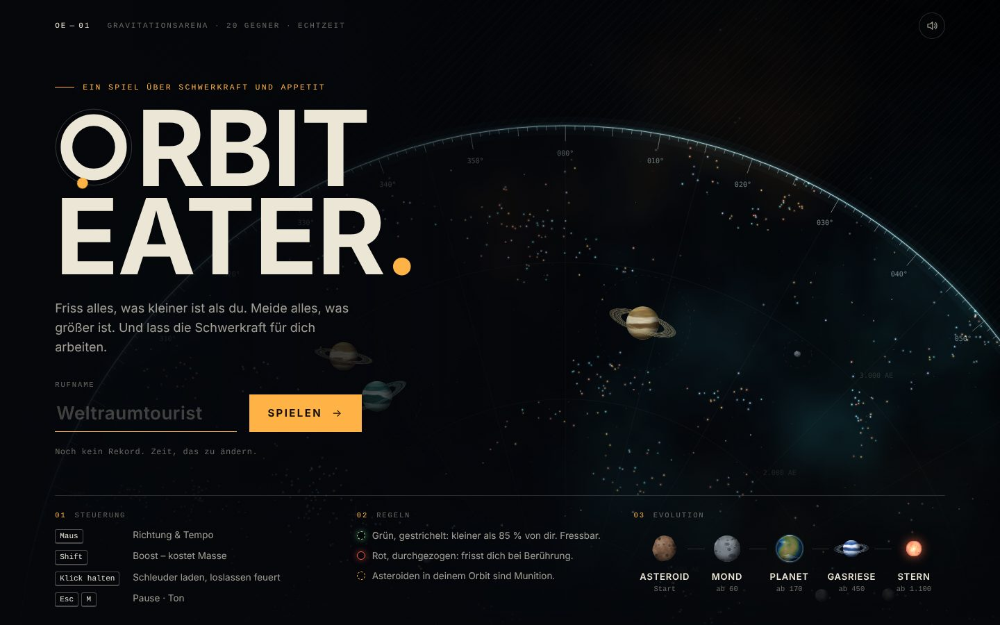
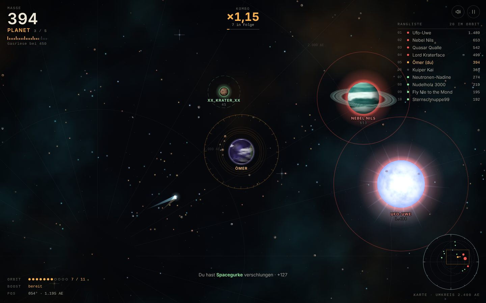

# ORBIT EATER

**Ein Browserspiel über Schwerkraft und Appetit.** Du bist ein kleiner Himmelskörper in einer
kreisrunden Arena. Friss, was kleiner ist, meide, was größer ist, und nutze deine eigene
Schwerkraft: Staub fällt in Spiralen auf dich zu, Asteroiden gehen in deine Umlaufbahn und
werden zu Munition. Vom Asteroiden über Mond, Planet und Gasriesen bis zum Stern.

Inspiriert vom Spielgefühl von slither.io und agar.io, aber mit eigener Mechanik
(Gravitation, Orbits, Schleuder) und eigener Gestaltung.




- Vanilla JavaScript (ES-Module) und Canvas 2D, ohne Framework und ohne Build-Schritt.
- **Keine einzige Asset-Datei:** Grafik, Texturen und Sounds entstehen zur Laufzeit im Code.
- 20 KI-Gegner, über 1.500 Objekte gleichzeitig, fester 60-Hz-Physiktakt.

---

## Starten

ES-Module laden nicht über `file://`. Ein Doppelklick auf `index.html` reicht deshalb nicht,
das Spiel braucht einen kleinen lokalen Webserver. Eine der folgenden Varianten genügt:

```bash
cd orbit-eater

npm start                    # eigener Mini-Server ohne Abhängigkeiten → http://localhost:8080
npx serve .                  # oder
python -m http.server 8000   # oder
```

Danach die angezeigte Adresse im Browser öffnen. Läuft in aktuellen Versionen von Chrome,
Edge, Firefox und Safari, am Desktop wie am Handy. Wer die Seite trotzdem per Doppelklick
öffnet, bekommt einen Hinweis angezeigt statt eines schwarzen Bildschirms.

## Steuerung

| Desktop | | Touch | |
|---|---|---|---|
| **Maus** | Richtung und Tempo (je weiter weg, desto schneller) | **Ziehen** | schwebender Joystick |
| **Shift** / **Leertaste** | Boost, kostet Masse | **2. Finger** oder **BOOST** | Boost |
| **Maustaste halten** | Schleuder laden, loslassen feuert | **SCHLEUDER** halten | laden, loslassen feuert |
| **Esc** / **P** | Pause | Pause-Knopf | Pause |
| **M** | Ton an/aus | Lautsprecher-Knopf | Ton an/aus |
| **Enter** | Start / Nochmal spielen | | |
| **F3** | Leistungsanzeige (FPS, Tick-Zeit, Objektzahlen) | | |

## Spielregeln

**Fressen.** Berührst du einen Körper mit weniger als 85 % deiner Masse, verschlingst du
ihn. Hat er mehr als etwa 118 % deiner Masse, verschlingt er dich. Dazwischen prallt ihr
voneinander ab. Die Farbe zeigt es sofort:

- grün, gestrichelter Ring: fressbar
- rot, durchgezogener und pulsierender Ring: Lebensgefahr
- gepunktet: ebenbürtig

Die Ringe unterscheiden sich auch in ihrer Form. So bleiben sie mit Rot-Grün-Schwäche
lesbar.

**Gravitationsbrunnen.** Jeder Körper zieht kleinere Objekte in seinem Gravitationsradius an,
der mit der Größe wächst:

- **Staub** fällt auf einer Spirale hinein.
- **Asteroiden** werden eingefangen und kreisen dann um dich. Jeder Orbiter gibt laufend Masse
  ab (Akkretion), bis er ganz geschluckt ist.
- **Kometen** sind schnell, aber 24 Masse wert. Gravitationsbrunnen lenken ihre Bahn sichtbar ab.

**Schleuder.** Halte die Maustaste: Deine Orbiter drehen schneller, die Bahnen weiten sich.
Beim Loslassen fliegen sie als Salve auf den Zeiger zu. Ein Treffer kostet das Ziel Masse.
Die herausgeschlagene Masse fliegt als Staub weg, den du einsammeln kannst. Fällt das Ziel
unter 10 Masse, zerbricht es. Du entscheidest also: Brocken langsam anwachsen lassen oder
als Munition verwenden?

**Boost.** Schneller, kostet aber laufend Masse. Sie bleibt als Staubspur hinter dir zurück
und kann von anderen gefressen werden. Unter 30 Masse gibt es keinen Boost.

**Evolution.**

| Stufe | ab Masse | Aussehen |
|---|---|---|
| Asteroid | Start (22) | unregelmäßiger Felsbrocken mit Kratern |
| Mond | 60 | kraterübersäte Kugel, dreht sich |
| Planet | 170 | Kontinente, Polkappen, eigene Wolkenschicht, Atmosphärensaum |
| Gasriese | 450 | Wolkenbänder, Sturmfleck, meist Ringe |
| Stern | 1.100 | Granulation, Korona, Strahlen |

Ab 150 Masse verdunstet langsam Masse. Riesen müssen also in Bewegung bleiben und können
nicht dauerhaft uneinholbar werden.

**Schwarze Löcher** entstehen selten, wandern langsam und leben etwa anderthalb Minuten:

- Der rot gestrichelte Kreis markiert ihren Sog.
- Wer den Horizont berührt, ist weg. Große Körper verlieren dort laufend Masse.
- Mit Boost kommt man raus, wenn man früh genug reagiert.
- Am Ende ihres Lebens verdampfen sie und spucken Staub aus.

**Kombo.** Wer schnell hintereinander frisst, baut eine Kombo auf (bis ×1,6 Masse). Die
Fress-Töne steigen dabei eine pentatonische Leiter hinauf.

**Rekord.** Gespeichert wird lokal im Browser (`localStorage`): die höchste erreichte Masse,
dazu Stufe, Kills und Überlebenszeit.

## Technik

### Architektur

```
             ┌──────────── Events ("eat", "death", "evolve", "hit" …) ────────────┐
             │                                                                     ▼
 input ──► game (Regeln) ──► physics · entities · spatial-hash · ai     renderer · audio · ui
             ▲                                                                     │
             └───────────────────── main (Schleife, Zustände) ◄────────────────────┘
```

Die Simulation (`game`, `physics`, `entities`, `ai`) kennt weder DOM noch Canvas. Sie meldet
alles, was passiert, über einen kleinen Event-Bus, und Darstellung, Ton und Interface hören
nur zu. Dadurch lässt sich die komplette Welt ohne Browser in Node testen (siehe unten).

### Physik

- **Fester Zeitschritt mit Interpolation.** Die Physik läuft immer mit 60 Hz über einen
  Akkumulator. Gezeichnet wird so oft, wie der Bildschirm kann, mit interpolierten Positionen
  zwischen den letzten beiden Ticks. Das Spiel verhält sich bei 30, 60 oder 144 FPS gleich.
- **Steuerung mit Trägheit.** Die Geschwindigkeit nähert sich exponentiell der
  Wunschgeschwindigkeit an. Externe Kräfte (Sog, Schwarze Löcher, Rückstoß) werden addiert
  und ergeben eine natürliche Drift. Schwerere Körper sind träger und langsamer.
- **Einfallspiralen statt Pendeln.** Staub wird im Brunnen auf eine Spirale gelenkt (radial
  plus tangential). Das liest sich wie Gravitation, ist aber numerisch stabil: kein
  Überschießen, kein Wegkatapultieren bei kleinem Abstand.
- **Kinematische Umlaufbahnen.** Eingefangene Asteroiden laufen auf Kreisbahnen mit weichem
  Einschwenken (Easing), innen schneller als außen. Ihre Bahnhöhe sinkt langsam ab.
- **Spatial Hash.** Ein festes Raster (160 Einheiten pro Zelle) wird jeden Tick neu
  aufgebaut. Es beantwortet alle Fragen der Art „was ist in meinem Gravitationsradius?“. Die
  rund 20 großen Körper werden direkt paarweise geprüft, bei dieser Anzahl ist das schneller
  als jede Datenstruktur.
- **Object Pooling** für Staub, Asteroiden, Kometen und alle Partikel. Im laufenden Spiel
  entsteht dadurch kaum Garbage.

### Bots

Jeder Bot schaut sich alle 0,12–0,28 s um (Reaktionszeit, je nach Persönlichkeit) und
bewertet, was in seinem Sichtradius liegt:

- **Bedrohungen** (größere Körper, Schwarze Löcher, Arenarand) ergeben einen Fluchtvektor.
  Der wird stärker, wenn die Gefahr auf ihn zukommt oder das Ziel hinter ihr liegt.
- **Gelegenheiten** (kleinere Körper, Kometen, Asteroiden als Munition, Staubwolken) bekommen
  einen Score aus Wert und Entfernung. Flinke Beute zählt weniger. Hysterese verhindert, dass
  ein Bot zwischen zwei Zielen hin- und herzappelt.

Beides wird gemischt und mit begrenzter Wendigkeit angesteuert. Bots boosten auf der Flucht
oder kurz vor dem Fang und schießen mit der Schleuder auf Rivalen, mit Vorhalt und
Zielfehler je nach Können. Sie benutzen exakt dieselbe Steuerschnittstelle wie der Spieler:
keine Abkürzungen, kein Blick durch Wände.

**Schwierigkeit:** Präzision und Jagdlust gegenüber dem Spieler steigen mit dessen Größe. In
den ersten Sekunden nach dem Spawn gibt es zusätzlich eine Schonfrist, damit man das Spiel
verstehen kann, bevor man gefressen wird.

### Grafik

Alle Grafik wird beim Start oder bei Bedarf aus Rauschen berechnet (kachelbares Value-Noise
und fBm) und als Offscreen-Canvas gecacht.

- **Kugeln, die sich drehen.** Planetentexturen sind Streifen, die eine volle Umdrehung
  enthalten. Beim Zeichnen wird das sichtbare Fenster in senkrechte Scheiben zerlegt, deren
  Breite dem Sinus der Länge folgt. Am Rand läuft die Oberfläche dadurch zusammen wie auf
  einer echten Kugel. Die Zeilen sind schon bei der Erzeugung nach Breitengrad verteilt,
  Krater werden zu den Polen hin passend gedehnt.
- **Aus einem Seed.** Jede Stufe hat mehrere Paletten (Erde, Wüste, Mars, Violett; Jupiter,
  Neptun, Saturn …). Bots sehen über ihren Seed nach jeder Evolution „verwandt“ aus.
- **Textur-Cache mit Vorwärmen.** Eine Planetentextur kostet rund 20 ms. Deshalb wird höchstens
  eine pro Frame gebaut, und zwar schon, wenn ein Körper sich der nächsten Stufe nähert. Beim
  Evolutions-Moment liegt sie bereit, es gibt keinen Ruckler.
- **Hintergrund.** Ein Nebel in der Hubble-Palette (Teal/Gold), drei Sternebenen mit
  Parallaxe und einzelne Sterne mit Beugungsspikes.
- **Arena wie eine Sternkarte.** Ein polares Gitter, eine Gradskala am Rand und ein
  schraffierter Außenbereich wie auf einer technischen Zeichnung.

### Ton

Alles läuft über die Web Audio API und wird in Echtzeit synthetisiert:

- Oszillatoren und gefiltertes Rauschen
- ein Hall über eine selbst erzeugte Impulsantwort, dazu ein Kompressor
- ein Ambient-Drone, Boost-Rauschen, ein steigender Ladeton der Schleuder und ein Dröhnen in
  der Nähe Schwarzer Löcher
- Ereignisse anderer Körper werden mit der Entfernung leiser und im Stereobild verortet

Lautstärke und Stummschaltung werden gespeichert.

### Gestaltung

Bewusst kein Arcade-Neon und kein Glas-Look. Die Richtung ist Messinstrument und Sternkarte:

- Haarlinien, Mono-Ziffern, viel Schwarz
- eine Akzentfarbe (Bernstein) für alles, was dir gehört
- Grün und Rot sind für fressbar und Gefahr reserviert

Schriften kommen ausschließlich aus dem System (Bahnschrift, DIN, Avenir, SF Mono, Cascadia …),
damit nichts nachgeladen werden muss. Bewegungen sind mit `prefers-reduced-motion` reduzierbar
(weniger Screen Shake, keine Zeitlupe).

## Projektstruktur

```
orbit-eater/
├── index.html            Seitengerüst: Start, HUD, Pause, Game Over, Fehlerhinweis für file://
├── css/style.css         komplettes Interface, Design-Tokens, responsives Layout
├── js/
│   ├── main.js           Einstieg: Hauptschleife (Fixed Timestep), Zustände, Verdrahtung
│   ├── config.js         ALLE Stellschrauben: Tempo, Massen, Radien, Spawnraten, Kamera …
│   ├── game.js           Welt und Regeln: Fressen, Orbit, Schleuder, Boost, Löcher, Spawns
│   ├── entities.js       Datenmodell (Body, Debris, BlackHole), Pool, abgeleitete Größen
│   ├── physics.js        Steuerung mit Trägheit, Spiralsog, Gravitation, Stoß
│   ├── spatial-hash.js   Raster für Nachbarschaftsabfragen
│   ├── ai.js             Bot-Gehirn: Steering + Bedrohungs-/Gelegenheits-Scoring
│   ├── names.js          Bot-Namen
│   ├── renderer.js       Zeichnen: Hintergrund, Welt, Körper, Effekte, Labels
│   ├── sprites.js        prozedurale Texturen und Sprites
│   ├── particles.js      Partikelsystem mit Objekt-Pool
│   ├── camera.js         Folgen, Auto-Zoom, Screen Shake (Trauma-Modell)
│   ├── input.js          Maus, Tastatur, Touch-Joystick
│   ├── audio.js          Sounddesign mit Web Audio
│   ├── ui.js             HUD, Rangliste, Minimap, Toasts, Hinweise, Menüs
│   ├── storage.js        abgesichertes localStorage
│   └── utils.js          Mathe, Easing, seedbarer Zufall, Rauschen, Event-Bus
├── tools/
│   ├── serve.mjs         statischer Entwicklungsserver (npm start)
│   ├── sim-test.mjs      Headless-Test der Simulation (npm test)
│   └── gallery.html      Galerie aller prozeduralen Körper
├── docs/                 Screenshots für diese README
└── eslint.config.js      Lint-Regeln (npx eslint .)
```

## Testen und Werkzeuge

```bash
npm test                        # 6 Minuten Spielzeit headless, Seed 1
node tools/sim-test.mjs 7 10    # Seed 7, 10 Minuten
npx eslint .                    # Lint
```

Der **Simulationstest** lässt die Welt in Node laufen und steuert einen Spieler per Autopilot
(dieselbe KI wie die Bots). Dabei prüft er laufend:

- keine NaN-Werte
- Zähler stimmen mit den tatsächlichen Objekten überein
- Orbiter gehören dem richtigen Körper
- es entstehen nie mehr Bots als vorgesehen

Am Ende berichtet er Tick-Zeit (im Schnitt ~0,3 ms, Budget 16,7 ms), Fortschritt des
Autopiloten und Ereignisstatistik. Mit diesem Test ist die Balance entstanden. Ein Beispiel:
Er zeigte, dass sich die Welt ohne Massenverdunstung innerhalb von fünf Minuten mit Riesen
füllt (Median der Bot-Masse von 85 auf über 1.000). Heute pendelt sie sich bei einem Median
um 350–450 ein, mit vereinzelten Sternen.

Im Browser zeigen `?debug` in der Adresse oder **F3** die FPS, die Zeit für Simulation und
Zeichnen sowie alle Objektzahlen an. `tools/gallery.html` rendert jede Stufe in mehreren
Paletten groß, um die prozedurale Grafik zu beurteilen.

## Bewusste Entscheidungen

- **Touch-Steuerung als schwebender Joystick** statt „zum Finger fliegen“. Auf dem Handy
  würde der Daumen sonst genau das verdecken, worauf man zusteuert. Boost kommt per zweitem
  Finger (wie gefordert) oder per Knopf, die Schleuder über einen eigenen Knopf.
- **„Gravitationsradius proportional zur Masse“** ist als proportional zum *Radius* umgesetzt
  (r · 2,6 + 36). Wörtlich linear mit der Masse würde ein Stern die halbe Arena ansaugen.
- **Umlaufbahnen sind kinematisch**, nicht frei simuliert. Echte N-Körper-Orbits brauchen
  Energieverlust zum Einfangen und sind empfindlich gegen große Zeitschritte. Die gewählte
  Lösung sieht wie Gravitation aus und bleibt immer stabil.
- **Eine fortlaufende Welt.** Das Spiel startet nicht jedes Mal eine neue Arena. Wie auf einem
  echten .io-Server läuft die Welt weiter, der Hintergrund des Startbildschirms ist die echte
  Simulation, und „Nochmal spielen“ setzt dich in dieselbe Arena.
- **Leichte Masseverdunstung ab 150** und ein Sog großer Körper auf kleinere. Beides war nicht
  gefordert, verhindert aber eine erstarrte Arena voller Riesen.

## Ideen für die Zukunft

- **Echter Multiplayer.** Ein autoritativer Server (Node + WebSocket) übernimmt
  `game.js` nahezu unverändert, weil die Simulation schon DOM-frei und deterministisch
  seedbar ist. Clients schicken nur Steuerbefehle (Richtung, Gas, Boost, Schleuder), der
  Server sendet Zustands-Snapshots. Dazu kommen Client-Side Prediction für den eigenen Körper,
  Interpolation für alle anderen und Interest Management über den vorhandenen Spatial Hash,
  damit jeder nur sieht, was in seiner Nähe ist.
- **Teams oder Sonnensysteme:** Spieler einer Gruppe dürfen sich gegenseitig umkreisen statt
  fressen.
- **Ereignisse in der Arena:** Meteoritenschauer, Supernova eines Sterns (Druckwelle, die
  alles nach außen schleudert), Wurmlöcher als Abkürzung.
- **Farbschema für Farbsehschwächen** (z. B. Blau/Orange statt Grün/Rot) als Einstellung.
- **Gamepad-Unterstützung** über die Gamepad API.
- **Online-Bestenliste** und Wiederholungen der besten Runden. Die Simulation ist seedbar,
  eine Runde ließe sich also aus Seed und Eingaben exakt nachspielen.
